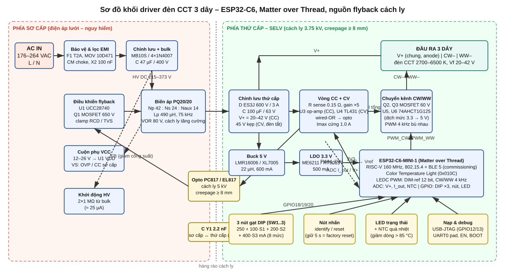

# matter-light-diver – Driver đèn CCT 3 dây, ESP32‑C6, Matter over Thread

Thiết kế hoàn chỉnh (tài liệu, sơ đồ nguyên lý, tính toán, floorplan PCB, BOM, firmware) cho **driver đèn LED điều chỉnh nhiệt độ màu loại 3 dây** (V+ chung, CW–, WW–) điều khiển bằng **ESP32‑C6** qua **Matter over Thread**, có **nguồn flyback cách ly** bên trong và **3 nút gạt chọn công suất**. Kiến trúc theo kiểu driver đèn thông minh thương mại: flyback CC/CV + MCU ở phía thứ cấp (SELV) + chuyển kênh CW/WW bằng PWM bù nhau.



| Thông số | Giá trị |
|---|---|
| Vào | 176–264 VAC |
| Ra | 20–42 V, 250–950 mA (8 mức DIP), 40 W max; bản 20 W cho PCB 30 × 60 mm |
| Điều khiển | Matter 1.x – Color Temperature Light, Thread FTD, commissioning BLE |
| Điều sáng | 1–100 % analog CC (12 bit), không nhấp nháy; CCT 2700–6500 K |
| Cách ly | tăng cường 3.75 kV, creepage ≥ 8 mm, opto 5 kV, tụ Y1 |
| PCB | KiCad 30 × 95 mm (40 W), 2 lớp, THT mặt trên / SMD mặt dưới; biến thể 30 × 60–65 mm (≤ 20 W) |

## Cấu trúc kho

```
docs/                      tài liệu thiết kế (tiếng Việt)
  01-tong-quan-kien-truc.md      yêu cầu, kiến trúc, bảng DIP
  02-nguon-cach-ly-flyback.md    tính toán flyback, biến áp, linh kiện sơ cấp
  03-thu-cap-cc-cv-dieu-sang.md  vòng CC/CV, PWM→DAC, chuyển kênh CW/WW, nguồn phụ
  04-mcu-esp32c6.md              GPIO, nạp/debug, anten
  05-pcb-layout.md               floorplan, khoảng cách an toàn, nhiệt
  06-firmware.md                 kiến trúc firmware, thuật toán, build, commissioning
  07-kiem-thu-an-toan.md         bring-up, kiểm thử, an toàn, EMC
  bom/BOM.csv                    danh mục linh kiện (có mã thay thế LCSC)
  images/block_diagram.svg       sơ đồ khối (sinh bởi gen_block_diagram.py)
hardware/
  kicad/                         DỰ ÁN KICAD (schematic + PCB 30x95 mm, Gerber, DSN) sinh từ design_db.py
  calc/flyback_calc.py           tính toán flyback (in bảng Markdown / JSON)
  calc/secondary_calc.py         bảng DIP, vòng CC, kẹp CV, MOSFET, nguồn phụ
  schematics/0X_*.svg            sơ đồ nguyên lý 7 khối (sinh bởi gen_0X_*.py, schemdraw)
  pcb/floorplan_30x90.svg        floorplan PCB (sinh bởi gen_floorplan.py)
firmware/                        dự án ESP-IDF 5.2 + esp-matter 1.3/1.4 (ESP32-C6)
  main/app_main.cpp              node Matter, endpoint 0x010C, OpenThread
  main/app_driver.cpp            LEDC/ADC/GPIO/nút/LED, tick 10 ms, bảo vệ
  main/light_engine.c            toán học điều sáng/CCT (thuần C)
  main/board_config.h            bản đồ chân, hằng số phần cứng
  test_host/                     unit test chạy bằng gcc
```

## Sơ đồ nguyên lý

| Khối | Tệp |
|---|---|
| 1 – Đầu vào AC, lọc EMI, chỉnh lưu | `hardware/schematics/01_input_filter.svg` |
| 2 – Flyback: T1 PQ20/20, Q1, clamp, cuộn phụ, chỉnh lưu thứ cấp | `02_flyback_stage.svg` |
| 3 – UCC28740, VS, HV start‑up, opto, tụ Y | `03_controller.svg` |
| 4 – Khuếch đại dòng, bộ lỗi CC, TL431 CV, tham chiếu PWM→DAC, ADC | `04_cc_cv_loop.svg` |
| 5 – Dịch mức, MOSFET CW/WW, shunt, đầu ra 3 dây | `05_output_switch.svg` |
| 6 – Buck 5 V, LDO 3.3 V | `06_aux_supply.svg` |
| 7 – ESP32‑C6‑MINI‑1, DIP, nút, LED, NTC, USB/UART | `07_mcu.svg` |

Sinh lại hình/tính toán (cần `pip install schemdraw`):

```bash
python3 hardware/calc/flyback_calc.py
python3 hardware/calc/secondary_calc.py
for f in hardware/schematics/gen_*.py docs/images/gen_block_diagram.py hardware/pcb/gen_floorplan.py; do python3 "$f"; done
```

## PCB KiCad

`hardware/kicad/` chứa project KiCad 7 (mở được bằng 7/8/9): `matter_cct_driver.kicad_pcb` (đặt linh kiện xong, đi dây tự động ≈ 70 % kết nối (160/230), phần đã đi sạch DRC; phần còn lại hoàn thiện tay hoặc Freerouting), schematic kết nối, thư viện footprint riêng (ESP32‑C6‑MINI‑1, PQ20/20, UU9.8…), Gerber/drill, PDF/SVG hai mặt và file DSN cho Freerouting. Toàn bộ được sinh từ `hardware/kicad/design_db.py` bằng API `pcbnew`; xem `hardware/kicad/README.md`.


## Firmware

```bash
. $IDF_PATH/export.sh && . $ESP_MATTER_PATH/export.sh
cd firmware && idf.py set-target esp32c6 && idf.py build flash monitor
# unit test logic điều sáng trên máy tính
cd firmware/test_host && cc -std=c11 -I../main test_light_engine.c ../main/light_engine.c -lm -o test && ./test
```

Firmware viết theo API esp‑matter v1.3/v1.4 + ESP‑IDF 5.2; `light_engine` đã được kiểm thử trên máy, phần còn lại chưa biên dịch trong môi trường này (không có toolchain ESP‑IDF) – xem `docs/06-firmware.md`.

## Cảnh báo an toàn

Phía sơ cấp mang điện áp lưới. Chỉ bring‑up qua biến áp cách ly/variac, không nối USB khi board đang cắm điện lưới, tuân thủ khoảng cách cách ly trong `docs/05`. Bản 40 W bán thương mại cần thêm PFC để đạt IEC 61000‑3‑2 lớp C (xem `docs/07`).
