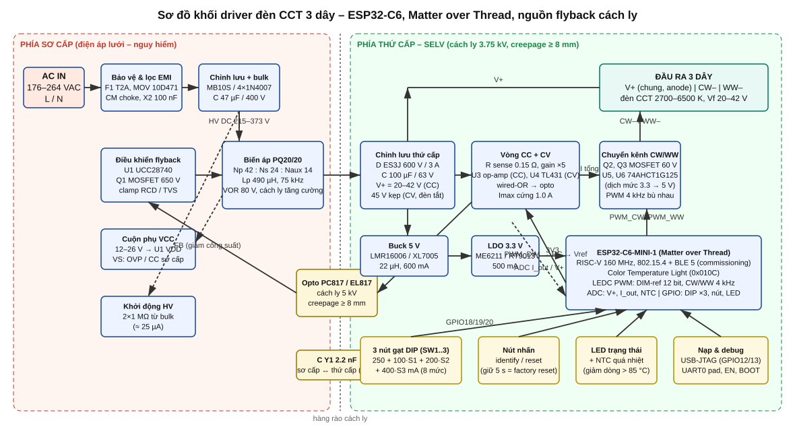

# 01 – Tổng quan yêu cầu và kiến trúc

Tài liệu này mô tả thiết kế driver (bộ nguồn điều khiển) cho đèn LED **điều chỉnh nhiệt độ màu loại 3 dây** (CCT, *common‑anode*: V+ chung, CW–, WW–), điều khiển bằng **ESP32‑C6** qua **Matter over Thread**, có **nguồn cách ly** bên trong và **3 nút gạt chọn công suất**. Kiến trúc bám theo các driver đèn thông minh thương mại (Tuya/Lifud/Mean Well kiểu "CC flyback + MCU thứ cấp + chuyển kênh CW/WW").



## 1. Yêu cầu kỹ thuật

| Mục | Giá trị thiết kế |
|---|---|
| Điện áp vào | 176–264 VAC, 50/60 Hz (220–240 V danh định; biến thể 100–277 V cần đổi tụ bulk, MOSFET, biến áp) |
| Công suất ra lớn nhất | 40 W (42 V × 0.95 A); bản rút gọn 20 W trên PCB 30 × 60 mm |
| Đầu ra | 3 dây: V+ (chung), CW– (trắng lạnh), WW– (trắng ấm) |
| Dải điện áp LED | 20–42 VDC (CC); kẹp 45 V (CV) khi đèn tắt / hở tải |
| Dòng ra (tổng CW+WW) | 8 mức chọn bằng 3 nút gạt: 250 / 350 / 450 / 550 / 650 / 750 / 850 / 950 mA (±5 %) |
| Giới hạn cứng | 1.0 A (phần cứng, không phụ thuộc firmware) + OVP ~50 V phía sơ cấp |
| Điều sáng | Analog CC 1–100 % (12 bit), không nhấp nháy (PWM kênh 4 kHz, dòng tổng không đổi) |
| Nhiệt độ màu | 2700–6500 K (153–370 mired), trộn theo tỉ lệ thời gian CW/WW |
| Giao tiếp | Matter 1.x, Thread (802.15.4), commissioning qua BLE; device type *Color Temperature Light* (0x010C) |
| Cách ly | Tăng cường (reinforced) sơ cấp ↔ thứ cấp: 3.75 kVAC biến áp, creepage ≥ 8 mm trên PCB, opto 5 kV, tụ Y1 |
| Công suất chờ | ≈ 0.7 W (Thread luôn nhận, đèn tắt) |
| Kích thước PCB | 30 × 90 mm (40 W) hoặc 30 × 60–65 mm (≤ 20 W), 2 lớp FR4 1.6 mm, đồng 2 oz |
| Vỏ | Nhựa PC (bắt buộc cho anten), IP20, lắp trong đèn ốp trần/âm trần |
| Nhiệt độ làm việc | –10…+50 °C môi trường; tc ≤ 85 °C; giảm dòng tự động > 85 °C (NTC) |

## 2. Kiến trúc tổng thể

```
AC ──► Lọc EMI ──► Chỉnh lưu ──► Flyback QR (UCC28740 + MOSFET 650 V) ──► T1 PQ20/20 ──┐
                                        ▲ FB (opto)                                     │
                                        │                                               ▼
                       ┌────────── Vòng CC (op-amp, Iref từ MCU) ◄── R shunt ◄── D2 / C4 ──► V+ ──► đèn (anode chung)
                       │           Vòng CV (TL431, 45 V)                                      │
                       │                                                       CW– ◄── Q2 ◄──┤
                       │                                                       WW– ◄── Q3 ◄──┘
                       │                                                            ▲ PWM bù nhau 4 kHz
                       └── Buck 5 V ──► LDO 3.3 V ──► ESP32-C6-MINI-1 (Matter/Thread) ──► PWM_DIM (Iref), DIP ×3, nút, LED, ADC, NTC
```

### 2.1 Vì sao chọn flyback điều khiển thứ cấp (SSR) thay vì PSR?

* Driver thương mại giá rẻ dùng PSR (BP3319, SM7525…) đặt dòng bằng điện trở phía **sơ cấp**; nút gạt chọn công suất khi đó nằm ở phần nguy hiểm hoặc phải dùng relay. Thiết kế này đặt **vòng dòng ở thứ cấp** (SELV): nút gạt, MCU, shunt đều an toàn khi người dùng thao tác.
* MCU đặt tham chiếu dòng bằng PWM lọc RC → điều sáng analog mịn 12 bit, không nhấp nháy; vẫn có **giới hạn cứng 1.0 A** bằng cầu chia điện trở nên lỗi firmware không thể quá dòng.
* Vòng CV (TL431 ở 45 V) giữ V+ khi đèn tắt để nuôi MCU – chính là cách các driver "always‑on" cho đèn thông minh hoạt động.
* UCC28740 có thêm giới hạn dòng sơ cấp, OVP, khởi động HV 700 V tích hợp, QR valley switching → hiệu suất ≈ 86–88 %.

### 2.2 Vì sao 3 dây dùng "chia thời gian" CW/WW?

Đèn CCT 3 dây là hai chuỗi LED chung anode, mỗi chuỗi chịu được toàn bộ dòng danh định. Driver cấp **một nguồn dòng không đổi** rồi đóng/ngắt bù nhau hai MOSFET ở tần số 4 kHz: tỉ lệ thời gian CW:WW quyết định nhiệt độ màu, độ sáng do mức dòng quyết định. Ưu điểm: một tầng công suất, tổng quang thông gần như không đổi khi đổi màu, không có "lỗ" dòng khi chuyển kênh nhờ tụ ra C4 (khe 1 µs chỉ làm V+ tăng 10 mV).

## 3. Chọn công suất bằng 3 nút gạt

Firmware đọc 3 GPIO (ON = nối GND) và đặt dòng tối đa theo bảng nhị phân có trọng số; bảng có thể đổi trong `firmware/main/board_config.h` (`DIP_CURRENT_TABLE_MA`).

| SW3 | SW2 | SW1 | I_out (mA) | P @ 36 V (W) |
|---|---|---|---|---|
| off | off | off | 250 | 9.0 |
| off | off | ON | 350 | 12.6 |
| off | ON | off | 450 | 16.2 |
| off | ON | ON | 550 | 19.8 |
| ON | off | off | 650 | 23.4 |
| ON | off | ON | 750 | 27.0 |
| ON | ON | off | 850 | 30.6 |
| ON | ON | ON | 950 | 34.2 |

Nếu chỉ muốn 3 mức kiểu thương mại (ví dụ 24 W / 36 W / 40 W), đổi bảng thành "ưu tiên nút cao nhất đang ON". Khi thay đổi nút gạt lúc đang chạy, firmware áp dụng sau 500 ms (lọc dội), không cần cấp nguồn lại.

## 4. Tài liệu liên quan

| Tệp | Nội dung |
|---|---|
| `02-nguon-cach-ly-flyback.md` | Tính toán flyback, biến áp, clamp, chọn linh kiện sơ cấp |
| `03-thu-cap-cc-cv-dieu-sang.md` | Vòng CC/CV, PWM→DAC, chuyển kênh CW/WW, nguồn phụ, đo lường |
| `04-mcu-esp32c6.md` | Khối MCU, bảng GPIO, nạp/debug, anten |
| `05-pcb-layout.md` | Floorplan 30 × 90 / 30 × 60 mm, khoảng cách an toàn, nhiệt, EMI |
| `06-firmware.md` | Kiến trúc firmware esp‑matter, thuật toán điều sáng/CCT, build & commissioning |
| `07-kiem-thu-an-toan.md` | Kế hoạch thử nghiệm, an toàn, EMC |
| `bom/BOM.csv` | Danh mục linh kiện có mã thay thế LCSC |
| `../hardware/schematics/*.svg` | Sơ đồ nguyên lý 7 khối |
| `../hardware/calc/*.py` | Script tính toán (chạy lại khi đổi thông số) |
| `../firmware/` | Dự án ESP‑IDF + esp‑matter |
