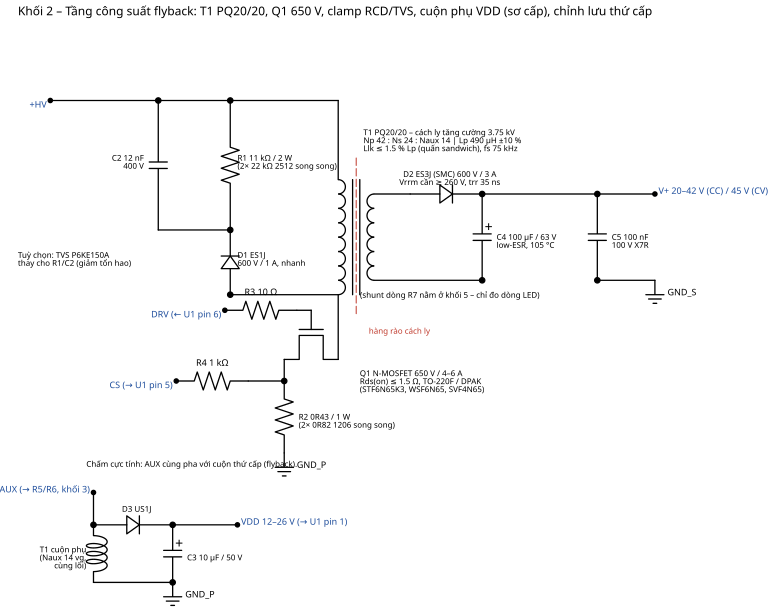
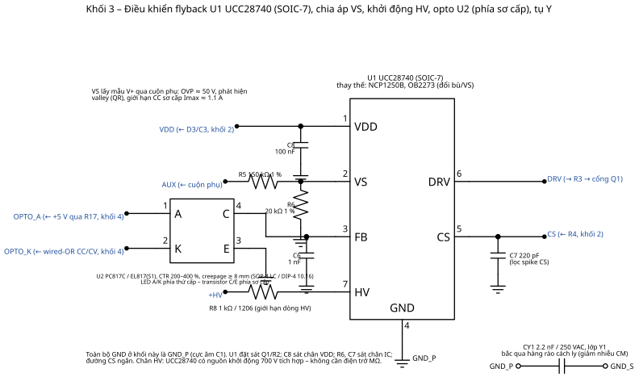

# 02 – Nguồn cách ly: flyback 40 W điều khiển thứ cấp

Sơ đồ: `../hardware/schematics/01_input_filter.svg`, `02_flyback_stage.svg`, `03_controller.svg`.
Số liệu dưới đây do `hardware/calc/flyback_calc.py` sinh ra; chạy lại script khi đổi thông số.

## 1. Thông số đầu vào thiết kế

| Thông số | Giá trị |
|---|---|
| Vac | 176–264 VAC, 50 Hz |
| Pout max có tải | 42 V × 0.95 A = 39.9 W |
| Hiệu suất giả định | 86 % → Pin ≈ 46.4 W |
| V+ kẹp CV (không tải) | 45 V |
| Tần số đóng cắt (tải lớn nhất, Vin min) | 75 kHz (QR, giảm tần khi tải nhẹ) |
| Điện áp phản xạ VOR | 80 V |
| Bmax | 0.30 T (PC95/PC40 @100 °C) |

## 2. Kết quả tính toán

| Đại lượng | Giá trị | Đơn vị |
|---|---|---|
| Đỉnh điện áp chỉnh lưu tại Vac_min | 249 | V |
| Tụ bulk tính toán / chọn | 33.8 / **47** | µF |
| V_bulk thấp nhất / cao nhất | 215 / 373 | V |
| Tỉ số vòng Np/Ns | 1.75 (42 : 24) | |
| Duty cực đại tại Vin_min | 0.27 | |
| Dòng đỉnh / RMS sơ cấp | 1.59 / 0.48 | A |
| Điện cảm sơ cấp Lp | **490 µH ±10 %** | |
| Dòng đỉnh / RMS thứ cấp | 2.76 / 1.36 | A |
| Số vòng Np : Ns : Naux | **42 : 24 : 14** | vòng |
| Vaux khi V+ = 20 V / 45 V | 11.7 / 26.3 | V |
| AL (có khe) / khe hở ước tính | 277 nH / 0.28 mm | |
| Dây sơ cấp / thứ cấp (J = 6 A/mm²) | Ø0.32 / Ø0.54 (dùng 2 × Ø0.4 TIW) | mm |
| Tỉ lệ lấp đầy cửa sổ | 0.99 (chấp nhận được với PQ20/20; dùng PQ26/20 nếu quấn tay) | |
| Vds MOSFET lớn nhất (có clamp 137 V) | 511 V → MOSFET 650 V, dự phòng 21 % | |
| Điện áp ngược diode ra | 258 V → ES3J 600 V | |
| R sense sơ cấp (Vcs 0.75 V) | 0.43 Ω (2 × 0.82 Ω 1206) – tổn hao 0.10 W | |
| Clamp RCD | 11 kΩ / 2 W, 12 nF / 400 V – tổn hao ≈ 1.7 W (hoặc TVS P6KE150A) | |
| Tổn hao diode ra | ≈ 1.1 W | |
| Ripple RMS qua tụ ra | 0.97 A → tụ low‑ESR 100 µF/63 V (ripple ≥ 1.1 A @100 kHz) | |

## 3. Đầu vào, bảo vệ, lọc EMI (khối 1)

* **F1** cầu chì chậm T2A/250 V – chịu xung nạp tụ bulk; **RV1** MOV 10D471 (275 VAC) sau cầu chì; **RT1** NTC 5Ω hạn dòng khởi động (có thể bỏ nếu dùng cầu chì 3.15 A và chấp nhận xung 20 A).
* **L1** cuộn chặn chế độ chung UU9.8 2 × 10 mH + **CX1** 100 nF X2 tạo bộ lọc π cùng với tụ bulk; đủ để đạt EN 55015 lớp B với layout tốt và tụ Y1 2.2 nF. Nếu dư nhiễu vi sai ở 150–500 kHz, thêm 1 cuộn vi sai 1 mH ở dây L.
* **BR1** → 4 diode **M7 (1N4007 SMA, D11–D14)** ở mặt dưới (pinout rõ ràng, rẻ): dòng trung bình 0.21 A, tổn hao ≈ 0.5 W.
* **C1** 47 µF/400 V: trên PCB dùng **2 × 22 µF/400 V 10 × 13 mm đứng** (C1, C27) để chiều cao ≤ 16 mm; ripple 100 Hz ≈ 0.4 A RMS chia đôi.

## 4. Tầng công suất (khối 2)

* **T1 PQ20/20**, bobbin 5 + 5 chân, quấn kiểu sandwich: ½ Np (21 vòng, 2 lớp) → Ns 24 vòng (2 × Ø0.4 TIW) → ½ Np (21 vòng) → Naux 14 vòng Ø0.2 (ngoài cùng, tránh xa Ns). Băng cách điện 3 lớp giữa sơ–thứ cấp nếu không dùng TIW. Điện cảm rò mục tiêu ≤ 7 µH (1.5 %). Thử nghiệm hipot 3.75 kVAC/1 phút sơ–thứ cấp.
* **Q1** MOSFET 650 V/4–6 A Rds ≤ 1.5 Ω (STD6N65K3, WSF6N65): tổn hao dẫn ≈ 0.48² × 1.5 × 1.4 (nhiệt) ≈ 0.5 W; chuyển mạch QR giảm tổn hao bật. DPAK với 2 cm² đồng (2 oz) → ΔT ≈ 40 °C.
* **Clamp**: trên PCB KiCad dùng TVS **P6SMB150A/SMBJ150A (SMB) nối tiếp D1 ES1J** (Vclamp ≈ 150 V, chỉ tiêu hao năng lượng rò). Phương án RCD tương đương: R1 11 kΩ/2 W (2 × 22 kΩ 2512) + C2 12 nF/400 V, tổn hao ≈ 1.7 W.
* **R2** 0.43 Ω: UCC28740 ngắt xung ở Vcs = 0.75 V → Ipk ≈ 1.75 A (cao hơn 1.59 A tính toán 10 % – dự phòng cho Lp +10 %).
* **D3/C3** cuộn phụ: 11.7–26.3 V vào VDD (UCC28740 chịu tới 38 V; UVLO tắt 7.75 V).
* **D2 ES3J (SMC)** + **C4** 100 µF/63 V + **C5** 100 nF/100 V: ripple V+ ≈ 0.3 Vpp. Đặt D2–C4–T1 thành vòng nhỏ nhất.

## 5. Bộ điều khiển UCC28740 (khối 3)

| Chân | Linh kiện | Giải thích |
|---|---|---|
| HV (7) | R8 1 kΩ → +HV | Nguồn khởi động 700 V tích hợp; nạp C3 đến 21 V rồi ngắt → không có tổn hao điện trở MΩ |
| VDD (1) | C3 10 µF + C8 100 nF | UVLO on/off 21 V / 7.75 V |
| VS (2) | R5 150 k / R6 20 k từ AUX | Lấy mẫu V+ qua cuộn phụ (tỉ lệ Naux/Ns = 0.583). OVP khi VS vượt ngưỡng ~ 50 V quy đổi; dùng để phát hiện đáy (valley) và tính giới hạn dòng sơ cấp (CC sơ cấp ≈ 1.1 A) |
| FB (3) | U2 collector + C6 1 nF | Dòng kéo từ opto giảm công suất; không dòng = công suất max (khởi động mềm nội) |
| CS (5) | R2 qua R4 1 kΩ + C7 220 pF | R4 đồng thời bù độ dốc/line (theo datasheet) |
| DRV (6) | R3 10 Ω → cổng Q1 | Đỉnh 1 A |
| GND (4) | GND_P | Nối thẳng cực âm C1 và R2 bằng đồng rộng |

Thay thế: NCP1250B (100 kHz, cần điện trở khởi động), OB2273/OB2263 (65 kHz, cố định, không QR) – cần tính lại Lp (65 kHz → Lp ≈ 560 µH, Np 48).

## 6. Khởi động và các chế độ hoạt động

1. Cấp AC → C1 nạp → HV startup nạp C3 → 21 V → U1 phát xung; FB chưa có dòng → công suất theo giới hạn CC sơ cấp (~1.1 A ra).
2. V+ tăng; khi > 7 V buck 5 V chạy, LDO cấp 3.3 V → ESP32‑C6 boot (~0.5 s). Trong lúc đó Q2/Q3 ngắt (pull‑down 100 kΩ), dòng LED = 0, vòng CV TL431 kẹp V+ = 45 V.
3. Firmware đọc DIP, đặt Iref, bật Q2/Q3 theo kịch bản "soft‑connect" (xem 03/06) → V+ hạ xuống Vf của đèn, vòng CC giữ dòng.
4. Đèn tắt: Iref ≈ 0, Q2/Q3 ngắt → trở về CV 45 V, flyback chạy burst ≈ 0.5–0.7 W.
5. Hở tải: TL431 kẹp 45 V; dự phòng OVP qua VS (~50 V). Ngắn mạch: CC sơ cấp giới hạn 1.1 A + firmware phát hiện V+ < 10 V khi đang bật → tắt kênh, thử lại sau 5 s.

## 7. Bản 20 W (PCB 30 × 60 mm)

| Thay đổi | 40 W | 20 W |
|---|---|---|
| Biến áp | PQ20/20, Lp 490 µH | EF16/EE16 hoặc EFD20, Lp 1.0 mH (Np 70 : Ns 40 : Naux 24, fs 75 kHz) |
| Tụ bulk | 47 µF/400 V 10 × 20 | 22 µF/400 V 8 × 12 |
| MOSFET | 650 V/4 A DPAK | 650 V/2 A SOT‑223 / DPAK |
| Diode ra | ES3J SMC | ES2J SMB |
| Dòng ra | 250–950 mA | 150–500 mA (đổi bảng DIP: 150 + 50·S1 + 100·S2 + 200·S3) |
| R7 shunt | 0.15 Ω | 0.30 Ω (giữ Imax cứng = 0.5 A) |
| Chiều dài PCB | 90 mm | 60–65 mm (bỏ RT1, CM choke UU9.8 → UU10.5 nằm, bulk nhỏ, giữ nguyên phần MCU) |
