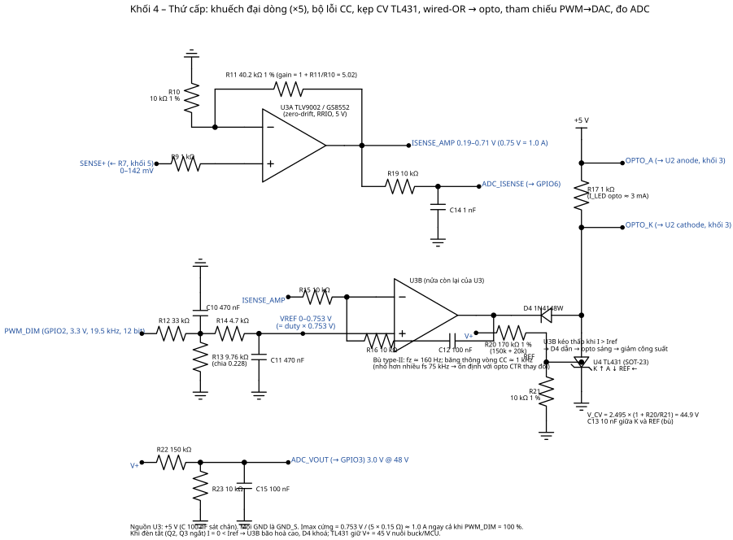
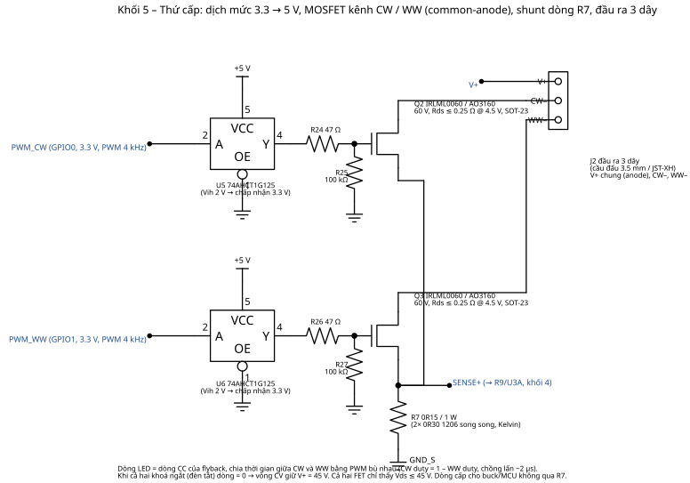
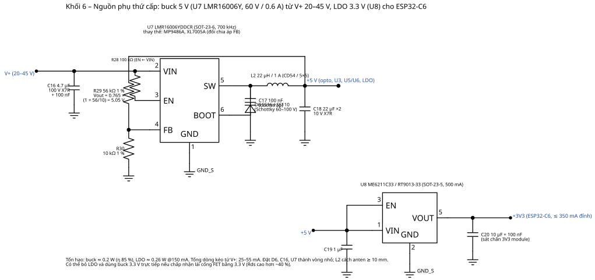

# 03 – Thứ cấp: vòng CC/CV, điều sáng, chuyển kênh CW/WW, nguồn phụ

Sơ đồ: `../hardware/schematics/04_cc_cv_loop.svg`, `05_output_switch.svg`, `06_aux_supply.svg`.
Số liệu từ `hardware/calc/secondary_calc.py`.

## 1. Đo dòng và vòng CC (khối 4)

* **R7 = 0.15 Ω** (2 × 0.30 Ω 1206, nối Kelvin) nằm ở đường nguồn chung của Q2/Q3 → chỉ đo **dòng LED**, không lẫn dòng nuôi buck/MCU (25–55 mA). Vsense = 37.5 mV @ 250 mA … 142.5 mV @ 950 mA; tổn hao 135 mW.
* **U3A** khuếch đại không đảo ×5.02 (R10 10 k, R11 40.2 k) → `ISENSE_AMP` = 0.19–0.71 V. Dùng op‑amp **zero‑drift/offset thấp** (TLV9002 ≤ 0.4 mV, GS8552 ≤ 10 µV) để sai số ở 1 % dim (≈ 10 mA → 7.5 mV sau khuếch đại) chấp nhận được. LMV358 (offset tới 7 mV) chỉ dùng cho bản không cần dim sâu.
* **Tham chiếu**: `PWM_DIM` (GPIO2, 19.53 kHz, 12 bit) → R12 33 k / R13 9.76 k (chia 0.228) + C10 470 nF → R14 4.7 k + C11 470 nF. Vref = duty × 0.753 V; ripple < 0.05 mV; thời gian xác lập ≈ 22 ms.
  **Imax cứng** = 0.753 / (5.02 × 0.15) ≈ **1.0 A** ngay cả khi PWM = 100 % – đây là giới hạn phần cứng không phụ thuộc firmware (và sơ cấp còn giới hạn 1.1 A).
* **U3B** bộ lỗi: in– = ISENSE_AMP qua R15 10 k; in+ = Vref; bù type‑II R16 10 k + C12 100 nF (fz ≈ 160 Hz). Khi I > Iref đầu ra kéo thấp → **D4** dẫn → kéo `OPTO_K` → opto sáng → sơ cấp giảm công suất. Khi I < Iref đầu ra bão hoà cao, D4 khoá (wired‑OR).
* Độ phân giải dòng 0.245 mA/LSB; duty cần cho từng mức DIP:

| DIP (S3S2S1) | I (mA) | duty 100 % sáng |
|---|---|---|
| 000 | 250 | 24.9 % (1020/4096) |
| 001 | 350 | 34.9 % |
| 010 | 450 | 44.8 % |
| 011 | 550 | 54.8 % |
| 100 | 650 | 64.7 % |
| 101 | 750 | 74.7 % |
| 110 | 850 | 84.6 % |
| 111 | 950 | 94.6 % (3875/4096) |

Firmware hiệu chuẩn 2 điểm (offset/gain) bằng ADC_ISENSE và lưu NVS; sai số dòng sau hiệu chuẩn ±3 %.

## 2. Vòng CV – kẹp 45 V

**U4 TL431** với R20 170 k (150 k + 20 k) / R21 10 k → V_CV = 2.495 × 18 = 44.9 V; C13 10 nF bù. Cathode TL431 nối thẳng `OPTO_K`: khi V+ > 45 V TL431 kéo opto. Chế độ này hoạt động khi đèn tắt, hở tải, hoặc trong lúc soft‑connect. Đèn có Vf > 43 V sẽ không đạt dòng – chọn đèn 20–42 V.

## 3. Opto và wired‑OR

LED opto cấp từ +5 V qua **R17 1 kΩ** (≈ 3 mA khi kéo hết; CTR 200 % → 6 mA ở FB, đủ cho UCC28740 cần ≤ 1 mA). Cả U3B (qua D4) và TL431 cùng kéo một nút: vòng nào yêu cầu giảm công suất nhiều hơn sẽ thắng – đúng nguyên lý CC/CV của adapter sạc.

## 4. Chuyển kênh CW/WW (khối 5)

* **Q2, Q3** IRLML0060 (60 V, Rds 0.25 Ω @ 4.5 V) – tổn hao 0.23 W ở 0.95 A, ΔT ≈ 56 °C trong SOT‑23 với 1 cm² đồng. Cổng được lái bằng **74AHCT1G125** (U5/U6, nguồn 5 V, ngưỡng vào TTL 2 V nên nhận trực tiếp 3.3 V của ESP32). R24/R26 47 Ω hạn dòng cổng, R25/R27 100 kΩ kéo xuống để FET ngắt khi MCU chưa boot.
* PWM bù nhau 4 kHz, độ phân giải 13 bit: `d_CW = D·N`, `d_WW = N – d_CW` với WW bắt đầu tại `hpoint = d_CW` (LEDC). Chồng lấn ~2 µs ở cạnh chuyển (CW dài thêm 2 µs) để tránh hở tải; khe hở ở cạnh còn lại (chu kỳ bộ đếm) ≤ 1 µs chỉ làm V+ tăng ΔV = I·t/C4 = 10 mV – không đáng kể.
* Tỉ lệ `w = (mired – 153)/(370 – 153)` → WW chiếm w, CW chiếm 1–w. Đèn 3 dây thường có quang thông hai kênh tương đương nên độ sáng không đổi theo màu; nếu không, firmware có bảng bù `CCT_LUMEN_COMP`.
* **Soft‑connect**: khi bật từ trạng thái CV 45 V, tụ C4 đang cao hơn Vf đèn 3–25 V. Firmware ramp hệ số kết nối `s` từ 0 → 1 trong 40 ms (cả hai kênh × s) để tụ xả dần qua LED thay vì xung dòng lớn; đồng thời Iref tăng dần. Sau ramp vòng CC tiếp quản.

## 5. Nguồn phụ (khối 6)

* **U7 LMR16006YDDCR** buck 5 V/0.6 A, Vin 4–60 V (V+ 20–45 V, kể cả 48 V quá độ). L2 22 µH/1 A, D6 SS16, C16 4.7 µF/100 V, C18 2 × 22 µF. FB: R29 56 k / R30 10 k → 5.05 V (Vfb 0.765 V). R28 100 k EN ← VIN. Dòng kéo từ V+: 24 mA @ 45 V, 53 mA @ 20 V.
* **U8 ME6211C33** LDO 5 → 3.3 V, 500 mA; tổn hao 0.26 W ở 150 mA. ESP32‑C6 đỉnh ≈ 350 mA khi phát BLE/802.15.4 → C20 10 µF + 100 nF sát chân module.
* +5 V cấp: opto, U3, U5/U6, LDO. Có thể thay bằng buck 3.3 V trực tiếp (bỏ LDO) nếu chấp nhận lái FET 3.3 V.

## 6. Đo lường cho firmware

| Tín hiệu | Mạch | Dải | Dùng để |
|---|---|---|---|
| ADC_ISENSE (GPIO6) | ISENSE_AMP qua R19 10 k + C14 1 nF | 0–0.75 V ↔ 0–1.0 A | hiệu chuẩn, phát hiện ngắn/hở, báo cáo |
| ADC_VOUT (GPIO3) | V+ qua 150 k / 10 k + 100 nF | 0–3.0 V ↔ 0–48 V | phát hiện không có đèn (V+ = 45 V khi bật), ngắn mạch (< 10 V), ước tính công suất |
| ADC_NTC (GPIO4) | 10 k / NTC 10 k B3950 | 25 °C = 1.65 V | giảm dòng > 85 °C, tắt > 100 °C |

Trên ESP32‑C6 dùng ADC1 với attenuation 11 dB (0–3.1 V), oversampling 64 mẫu.
