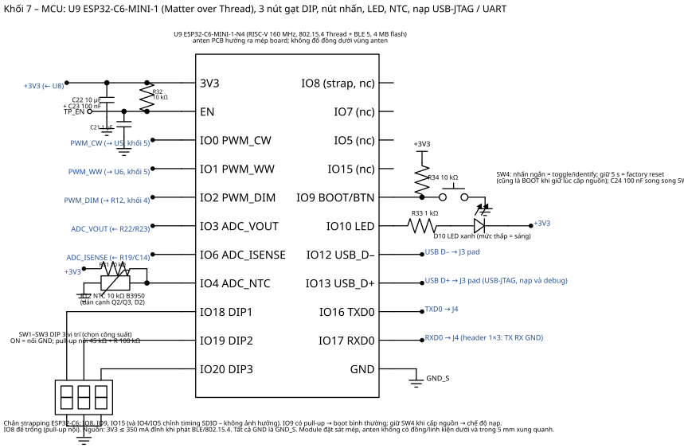

# 04 – Khối MCU ESP32‑C6 (Matter over Thread)

Sơ đồ: `../hardware/schematics/07_mcu.svg`

## 1. Module

**U9 ESP32‑C6‑MINI‑1‑N4** (13.2 × 16.6 × 2.4 mm, anten PCB, flash 4 MB): RISC‑V 160 MHz, 802.15.4 (Thread/Zigbee) + BLE 5 + Wi‑Fi 6 (không dùng). Chọn MINI‑1 vì vừa bề rộng 30 mm; nếu muốn anten ngoài dùng MINI‑1U (U.FL); nếu cần flash 8 MB dùng **ESP32‑C6‑WROOM‑1‑N8** (18 × 25.5 mm).

Nguồn: 3.3 V ±5 %, đỉnh ≈ 350 mA khi phát 802.15.4/BLE 20 dBm; trung bình khi đèn tắt ≈ 60–80 mA (Thread router luôn nhận). Tụ 10 µF + 100 nF sát chân 3V3; EN có R 10 k + C 1 µF (reset chậm 10 ms) và test‑point.

## 2. Bảng GPIO

| GPIO | Tên | Hướng | Chức năng | Ghi chú |
|---|---|---|---|---|
| 0 | PWM_CW | out | LEDC ch0, 4 kHz, 13 bit → U5 → Q2 | |
| 1 | PWM_WW | out | LEDC ch1, cùng timer với ch0, `hpoint` = duty CW | |
| 2 | PWM_DIM | out | LEDC ch2, 19.53 kHz, 12 bit → RC → Vref (0–0.753 V) | 100 % duty = 1.0 A (kẹp cứng) |
| 3 | ADC_VOUT | ADC1_CH3 | V+ qua 150 k/10 k | 48 V → 3.0 V |
| 4 | ADC_NTC | ADC1_CH4 | nhiệt độ board | strapping SDIO – không ảnh hưởng |
| 6 | ADC_ISENSE | ADC1_CH6 | dòng LED (0.753 V = 1 A) | |
| 9 | BUTTON | in, pull‑up | nhấn ngắn = toggle/identify; giữ 5 s = factory reset | cũng là BOOT: giữ khi cấp nguồn → chế độ nạp |
| 7 | STATUS_LED | out | mức thấp = sáng (IO10 không có trên module MINI‑1) | nháy theo trạng thái commissioning |
| 12 / 13 | USB D– / D+ | – | USB‑Serial‑JTAG nạp & debug (pad J3) | **không** nối 5 V USB khi board đang cắm điện lưới |
| 16 / 17 | TXD0 / RXD0 | – | UART0 log (header J4) | |
| 18 / 19 / 20 | DIP1 / DIP2 / DIP3 | in, pull‑up | 3 nút gạt chọn công suất (ON = GND) | đọc lúc boot + poll 100 ms |
| 8, 15 | – | – | strapping, để trống | |

## 3. Nạp, debug, sản xuất

* **Nạp lần đầu**: cấp 5 V vào pad J3 (USB) *khi board không nối điện lưới*, hoặc dùng nguồn 24–45 V DC vào V+/GND_S để chạy toàn bộ phần thứ cấp độc lập (an toàn khi phát triển firmware). `idf.py -p /dev/ttyACM0 flash monitor`.
* **Dữ liệu factory Matter** (DAC/PAI, discriminator, passcode, QR): tạo bằng `esp-matter-mfg-tool`, ghi vào phân vùng `fctry` (xem `docs/06`). Bản phát triển dùng chứng chỉ test của CSA.
* **Debug JTAG**: USB‑Serial‑JTAG tích hợp (OpenOCD `board/esp32c6-builtin.cfg`).

## 4. Anten và vỏ

* Module đặt sát mép board, phần anten (≈ 6 mm cuối module) nằm trên vùng không đồng cả hai lớp, không linh kiện trong 5 mm, cách cuộn buck L2 ≥ 10 mm, cách biến áp ≥ 25 mm.
* Vỏ driver phải là nhựa (PC/ABS chống cháy V‑0). Nếu đèn có thân kim loại, đặt driver sao cho anten không bị bao kín hoặc dùng MINI‑1U với anten ngoài dán vào vỏ nhựa.
* Nhiễu chuyển mạch 75 kHz/700 kHz chỉ ảnh hưởng 2.4 GHz qua hài bậc cao → giữ vòng chuyển mạch nhỏ, tụ Y gần biến áp.

## 5. Giao diện người dùng

| Hành động | Phản hồi |
|---|---|
| Cấp nguồn | LED nháy 1 Hz khi chưa commission; sáng 2 s khi đã vào mạng Thread rồi tắt |
| Nhấn ngắn nút | Toggle đèn tại chỗ (cập nhật Matter OnOff) |
| Giữ 5 s | LED nháy nhanh; thả → factory reset (xoá fabric, về chế độ pairing) |
| Lệnh Identify | Đèn nhấp nháy nhẹ trong thời gian identify |
| Đổi nút gạt khi đang chạy | Áp dụng sau 500 ms, log mức mới |
| Lỗi (không đèn / ngắn mạch / quá nhiệt) | LED nháy 2 / 5 / 3 lần, thử lại sau 5 s |
