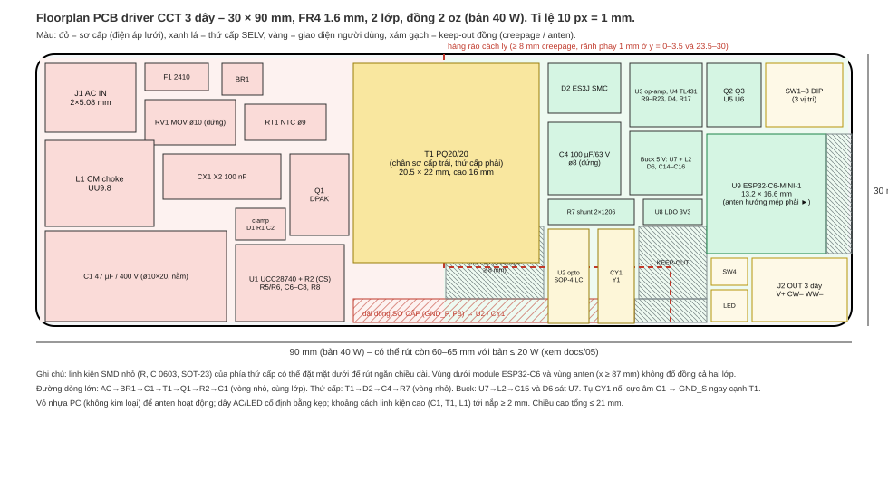

# 05 – PCB: floorplan 30 × 90 mm (40 W) và 30 × 60 mm (20 W)

Script sinh hình: `hardware/pcb/gen_floorplan.py` (tọa độ mm).

## 1. Stack‑up và quy tắc

| Mục | Giá trị |
|---|---|
| Vật liệu | FR4 Tg150, 1.6 mm, 2 lớp, đồng 2 oz (70 µm) cả hai mặt |
| Track/space min | 0.2 / 0.2 mm (tín hiệu), 0.3 mm (via–via) |
| Via | 0.3 / 0.6 mm; via nhiệt 0.3 mm lưới 1 mm dưới DPAK, SMC, SOT‑23 Q2/Q3 |
| Track công suất | ≥ 2 mm (2 oz) cho V+, GND_S, dòng LED; ≥ 1 mm phía sơ cấp |
| Đồng khuyết | Không đổ đồng dưới module ESP32‑C6 và vùng anten; không đồng sơ cấp cách thứ cấp < 8 mm |
| Mặt lắp | Sơ cấp: THT (J1, L1, C1, T1, CY1) + SMD mặt trên. Thứ cấp: SMD nhỏ có thể đặt mặt dưới |
| Silkscreen | Ký hiệu nguy hiểm vùng sơ cấp; "SELV" vùng thứ cấp; bảng DIP in cạnh SW1‑3 |

## 2. Khoảng cách an toàn (IEC 61347‑1 / IEC 62368‑1, 250 VAC, PD2, CTI ≥ 175)

| Vị trí | Yêu cầu | Thiết kế |
|---|---|---|
| L–N trước cầu chì | ≥ 2.5 mm creepage | 3.0 mm |
| Sau chỉnh lưu (+HV ↔ GND_P) | ≥ 2.0 mm | 2.5 mm |
| Sơ cấp ↔ thứ cấp (reinforced) | ≥ 6.4 mm creepage, 5.5 mm clearance | **≥ 8 mm**, rãnh phay 1 mm tại hai đầu hàng rào |
| Biến áp T1 | 3.75 kVAC 1 phút, hai hàng chân cách ≥ 8 mm | PQ20/20 bobbin 5+5, dây TIW thứ cấp |
| Opto U2 | creepage ≥ 8 mm trên thân | SOP‑4 long‑creepage 10.16 mm hoặc DIP‑4 10.16 |
| Tụ CY1 | Y1 (hoặc 2 × Y2 nối tiếp), chân cách 10 mm | disc Y1 2.2 nF pitch 10 mm |
| Linh kiện tới vỏ | ≥ 2 mm tới vỏ nhựa; ≥ 6 mm tới bề mặt kim loại | lắp trên đệm nhựa |

Hàng rào cách ly zig‑zag (đường đỏ): dọc giữa biến áp (x = 45 mm), rẽ ngang ở y = 23.5 mm từ x = 45 → 70 mm rồi xuống mép dưới. Dải đồng sơ cấp dưới biến áp (y ≥ 27 mm) chỉ mang GND_P và FB tới U2/CY1 đặt **thẳng đứng** (chân sơ cấp y ≈ 29 mm, chân thứ cấp y ≈ 19 mm, cách 10 mm). Vùng gạch xám là keep‑out đồng thứ cấp để giữ 8 mm tới dải sơ cấp.

## 3. Bố trí theo dòng điện

1. **Vòng sơ cấp** AC → F1 → RV1/L1/CX1 → BR1 → C1(+) → T1 → Q1 → R2 → C1(–): C1, T1, Q1, R2 đặt cạnh nhau; GND_P là đồng rộng liên tục từ C1(–) tới R2 và GND U1. Đường drain Q1 < 10 mm.
2. **Clamp** D1/R1/C2 sát chân sơ cấp của T1.
3. **U1**: C8 cách chân VDD < 3 mm; R6/C7 sát VS/CS; đường CS nối Kelvin tại R2.
4. **Vòng thứ cấp** T1 → D2 → C4 → GND_S → R7 → Q2/Q3: D2 và C4 sát chân biến áp; R7 Kelvin (hai track riêng tới R9/R10 của U3A).
5. **Buck U7**: C16 sát VIN/GND, D6 sát SW/GND, L2 ngay sau SW; mặt phẳng GND_S dưới toàn bộ thứ cấp.
6. **Module**: C22/C23 cạnh chân 3V3; dây PWM/ADC ngắn; RC lọc ADC sát chân module.
7. **CY1** nối GND_P (cực âm C1) ↔ GND_S bằng đường ngắn nhất, không song song dây tín hiệu.

## 4. Nhiệt

| Linh kiện | Tổn hao | Giải pháp |
|---|---|---|
| Q1 DPAK | ≈ 0.6 W | tab nối đồng 3 cm² hai lớp + 12 via nhiệt |
| D2 SMC | ≈ 1.1 W | cathode pad 3 cm² + via; đặt xa module |
| R1 clamp | ≈ 1.7 W | 2 × 2512 cách nhau 3 mm, xa tụ điện phân |
| T1 | ≈ 1.5 W | lõi hở, cách vỏ 2 mm |
| Q2/Q3 | 0.23 W (chỉ một con dẫn tại một thời điểm) | 1 cm² đồng mỗi con |
| U8 LDO | 0.26 W | 1 cm² đồng |
| C1, C4 | ripple | cách Q1/D2/R1 ≥ 5 mm, tuổi thọ ≥ 5 000 h @105 °C |

Tổng tổn hao ≈ 6 W ở 40 W → ΔT trong vỏ kín ≈ 25–30 °C. NTC RT2 dán cạnh D2/Q2 để giảm dòng khi tc > 85 °C.

## 5. Bản 30 × 60 mm (≤ 20 W)

Giữ phần thứ cấp (rút từ 45 mm còn ≈ 30 mm bằng cách đặt R/C mặt dưới, U3 SOIC‑8 chung), rút phần sơ cấp từ 45 mm còn 30 mm:

* Biến áp EF16/EFD20, tụ bulk 22 µF/400 V 8 × 12 đứng, bỏ RT1, CM choke UU9.8 → UU10.5 nằm hoặc 2 × 2.2 mH DM.
* Q1 SOT‑223/DPAK 2 A, D2 ES2J SMB, U1 giữ nguyên.
* Module ESP32‑C6‑MINI‑1 vẫn ở cuối board, anten hướng ra ngoài.
* Tổng chiều dài 60–65 mm; chiều cao ≤ 17 mm.
